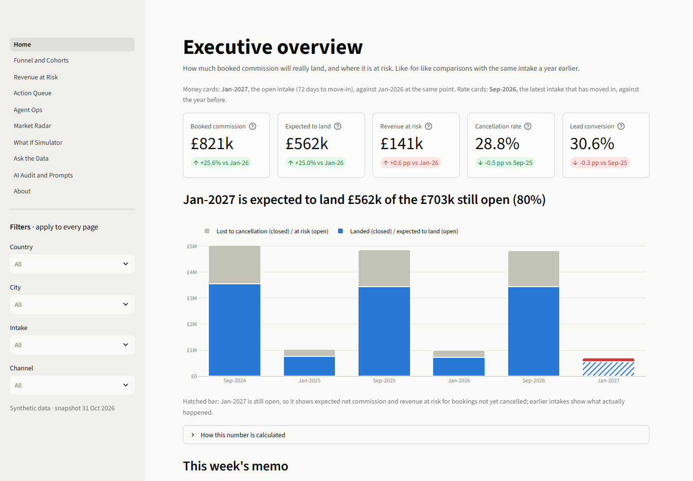
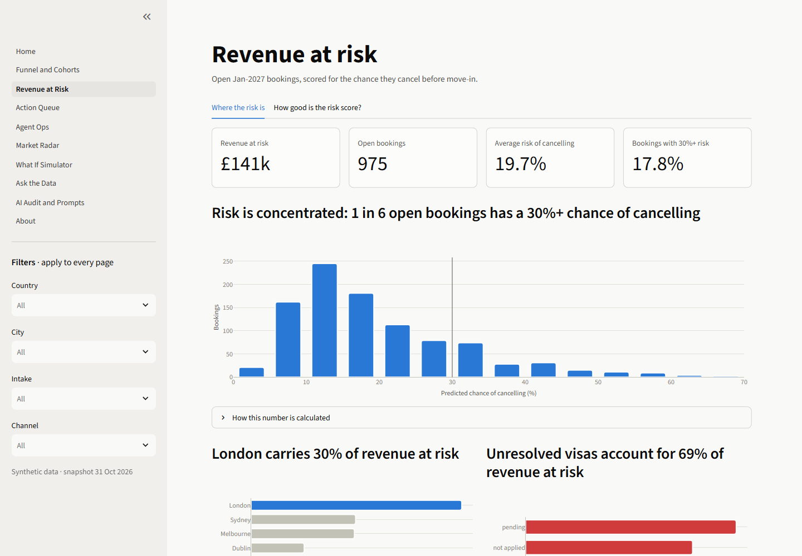
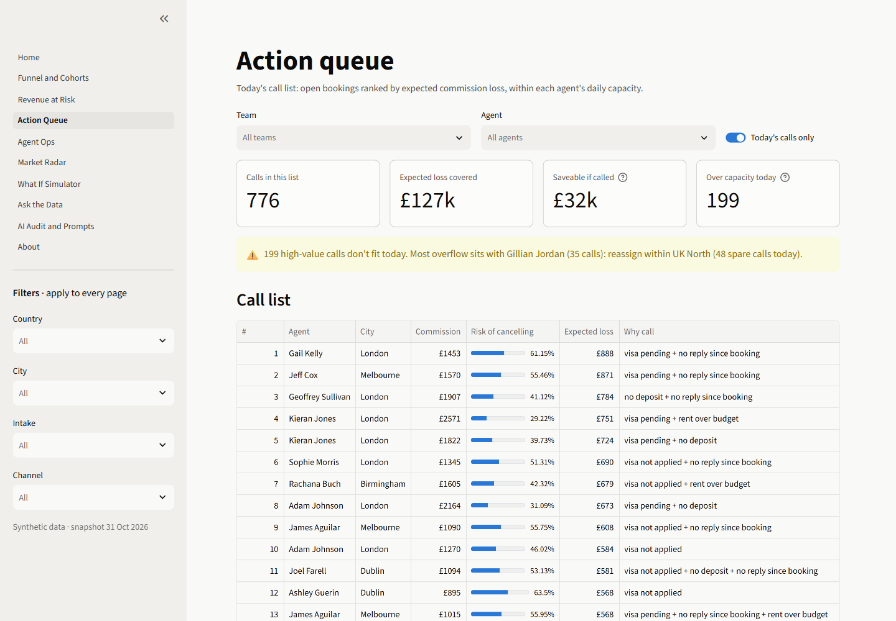
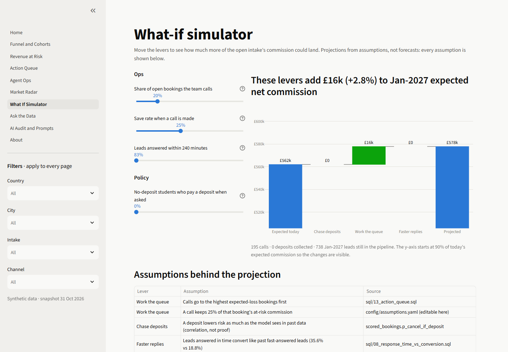
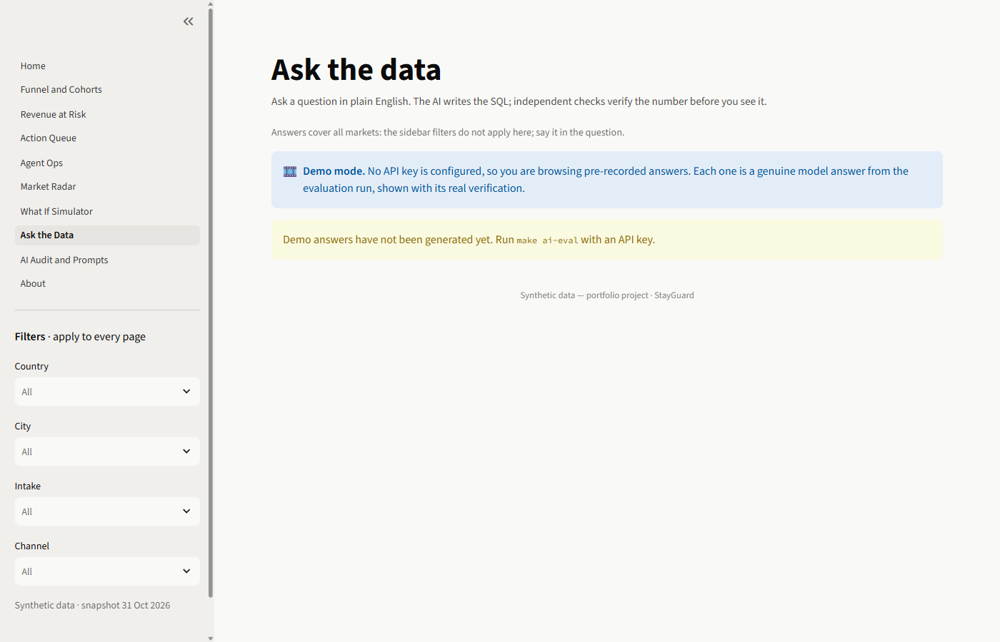
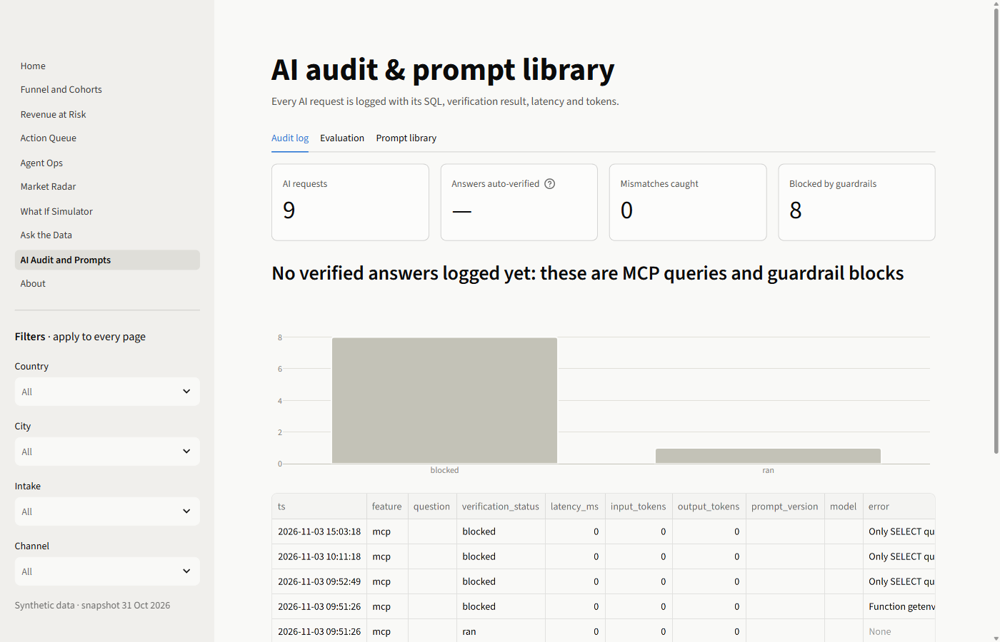
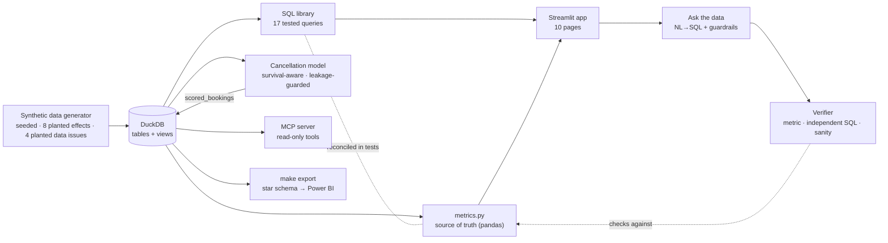

# StayGuard: Booking Risk Copilot

**Live demo:** [stayguard-booking-risk.streamlit.app](https://stayguard-booking-risk.streamlit.app) (synthetic data; the first visit after a quiet spell can take a minute to wake up)
<!-- Loom walkthrough link goes here once recorded. -->

**Built by Alex Abraham — MBA Business Analytics** · Code: [github.com/alexabraham629-ux/stayguard](https://github.com/alexabraham629-ux/stayguard) · [MIT licence](LICENSE)

StayGuard forecasts how much of a student-housing marketplace's booked commission will actually land.
It ranks which students booking managers should call today, and shows which cities, channels and intakes leak revenue.
Anyone can ask the data in plain English, and every AI answer is checked independently before it is shown.

> **Synthetic data, portfolio project.** Inspired by the business model of student-housing
> marketplaces such as Amber. No real company data, names or brand assets are used, and the app is
> not affiliated with any company.



## The problem in 30 seconds

A student-housing marketplace earns commission from property operators, but only once the student
moves in. Until then the money is at risk: visa refusals, no university place, cooling-off periods,
and students who find something cheaper. Finance plans on *booked* commission and gets surprised;
booking managers call students in no particular order; ad-hoc questions wait days for an analyst.

StayGuard answers three questions:

1. **Finance:** how much will really land? (Expected Net Commission, Revenue at Risk)
2. **Operations:** which students should we call today, within each agent's capacity?
3. **Strategy:** which cities, countries, channels and intakes are leaking revenue?

## Key findings

The full list, with method and recommendations, is in [docs/FINDINGS.md](docs/FINDINGS.md) (seed-20261031 build).

- **£562k of the £703k still open for Jan-2027 is expected to land.** £141k (20.1%) is at risk, and
  London holds 30% of it.
- **The risk model ranks well.** Calling the riskiest 20% saves **2.3x** the commission of random
  calling.
- **Early bookers are risky early, not late.** Among bookings still alive 72 days before move-in,
  early bookers are the *lower*-risk group, so a "booked 7 months early" rule would send agents to the
  wrong students.
- **Three levers project +£28k (+5.0%) for Jan-2027:** a risk-ranked call queue, chasing deposits, and a
  response-time target. This is a labelled projection, not a forecast.

| Revenue at risk | Today's call list | What-if simulator |
|---|---|---|
|  |  |  |

## What's inside

| Page | For | What it shows |
|---|---|---|
| Executive overview | Finance | KPI cards with like-for-like deltas, commission landed vs at risk by intake, weekly memo |
| Funnel & cohorts | City managers | Funnel, cancellation curves by intake, enquiry seasonality |
| Revenue at risk | Finance | Where the risk is, plus a plain-English tab on how good the risk score is |
| Action queue | Ops | Today's call list with reasons to call, within agent capacity, as CSV |
| Agent ops | Ops | Workload vs cancellations, leaderboard, response-time impact |
| Market radar | Strategy | YoY postgraduate demand, value per lead by channel, budget bands |
| What-if simulator | Finance × Ops | Queue share, save rate, deposits and SLA → projected ENC, with every assumption shown |
| Ask the data | Anyone | Plain English → SQL → answer, with a ✅ / ⚠️ / ◻️ verification badge |
| AI audit & prompts | Analytics | Every AI call, verification rate, the eval, versioned prompts |
| About | Everyone | Problem, personas, method, architecture |

Every chart's title states the insight, and every chart has a **"How this number is calculated"**
panel. It names the SQL file, says which filters applied, and shows the data table.

## How AI is used, and verified

- **Ask the data (NL → SQL):** Claude writes one DuckDB query. **Guardrails in code** reject anything
  but a single SELECT on whitelisted tables, file or environment access, more than 1,000 rows, and
  queries over 10 s. The query runs on a **read-only** connection; one self-repair retry is allowed on
  SQL errors.
- **Independent verifier:** every answer goes through three checks before it is shown.
  1. The canonical metric is recomputed in `metrics.py` (pandas, independent of SQL).
  2. A *separate* prompt writes its own query without seeing the first one, and the results are
     compared.
  3. Sanity checks for summed local currencies, raw duplicate rows, a period that doesn't match the
     question, and impossible counts.

  A test runs the whole eval with a deliberately careless fake model. **Every trap answer is flagged
  and none is verified.**
- **Grounded memo:** the weekly memo is written *only* from a JSON snapshot of the metrics. A number
  checker requires every figure in it to appear in that JSON, regenerates once if not, then highlights
  unmatched numbers in red.
- **MCP server:** Claude Code or Claude Desktop can query the database directly, with the same
  guardrails (see below).
- **Audit:** every AI call is logged with its prompt version, SQL, verdict, latency and tokens.

**Status:** all of this is tested offline with a scripted model (209 tests, no API key needed). The
live 15-question eval (`make ai-eval`, about $1) hasn't been run yet because no API key is available
(ADR-027). Until then Ask the Data shows "demo answers not generated", rather than fabricated answers.

| Ask the data today (demo mode, no answers recorded yet) | AI audit log (MCP queries and guardrail blocks) |
|---|---|
|  |  |

### How AI was used to build it

StayGuard was built with **Claude Code** from a single spec, [`CLAUDE.md`](CLAUDE.md), one phase at a
time. Every phase ended with tests, lint, a commit and my review.
- **[docs/AI_LOG.md](docs/AI_LOG.md) records every genuine mistake the AI made and how each was
  caught**, from adding currencies together to a generator bug that skewed the model's scores.
- **[docs/DECISIONS.md](docs/DECISIONS.md)** has 28 decision records.
- **[docs/PROMPTS.md](docs/PROMPTS.md)** is the reusable prompt library.

## Architecture



## Tech stack

Python 3.12 · uv · DuckDB · pandas / NumPy · Faker · scikit-learn · Plotly · Streamlit · Anthropic SDK
(Claude) · sqlglot · MCP Python SDK · pytest · ruff.

## Run it

Prerequisites: [uv](https://docs.astral.sh/uv/) and GNU make (Windows: `winget install ezwinports.make`).

```bash
make setup   # .venv with Python 3.12 + locked dependencies
make data    # generate data (~5 s), build data/stayguard.duckdb, train and score the model
make app     # open http://localhost:8501
```

| Target | What it does |
|---|---|
| `make test` | 209 tests: data, SQL reconciliation, model, app pages, AI layer, MCP, release. No key needed |
| `make lint` | ruff check + format check |
| `make quality` | Data-quality report (15 integrity rules + 4 planted issues) |
| `make export` | Star schema as CSV + Parquet in `data/exports/` for Power BI / Tableau |
| `make ai-eval` / `make ai-memo` | Live AI eval and memo (need `ANTHROPIC_API_KEY` in `.env`) |

Live AI features: copy `.env.example` to `.env` and add your own `ANTHROPIC_API_KEY`. Without one,
everything else works and the AI pages run in demo mode. The EDA story is in
[notebooks/01_eda.ipynb](notebooks/01_eda.ipynb); rebuild it with `uv run python notebooks/build_eda.py`.

## Power BI

[dashboards/powerbi_spec.md](dashboards/powerbi_spec.md) covers building the dashboard from
`make export` in about two hours:
- the star schema and its relationships
- 16 DAX measures (ENC, Revenue at Risk, cancellation rate, YoY %, rolling 4-week cancellation, agent
  load, saveable revenue with What-if parameters)
- three page layouts
- a table of expected totals to reconcile against before sharing

## Query the data from Claude (MCP)

`mcp_server/server.py` is a read-only [MCP](https://modelcontextprotocol.io) server. With it, Claude Code
or Claude Desktop can explore and query the StayGuard database directly. It needs no Anthropic API key:
the Claude client you already use does the reasoning.

| Tool | What it does |
|---|---|
| `list_tables` | Tables and views you may query, with row counts and descriptions |
| `describe_table(name)` | Columns, types, notes and three sample rows |
| `run_readonly_query(sql, max_rows=200)` | One SELECT through the app's guardrails. Warns about summed local currencies and raw duplicate rows |
| `get_metric(name, filters)` | The canonical value from `stayguard.metrics`, e.g. `revenue_at_risk` for `{"cities": ["London"]}` |

**Claude Code:** the server is registered in `.mcp.json`. Start Claude Code in this folder, approve the
`stayguard` server when asked, then ask, for example, *"Using stayguard, which cities carry the most
revenue at risk?"*. Check it's connected with `claude mcp list`.

**Claude Desktop:** add this to `claude_desktop_config.json`, using your own path:

```json
{
  "mcpServers": {
    "stayguard": {
      "command": "uv",
      "args": ["run", "--directory", "C:/path/to/stayguard", "python", "mcp_server/server.py"]
    }
  }
}
```

Close the app and the MCP server before re-running `make data`: DuckDB allows many read-only readers
*or* one writer at a time.

## Repository map

```
app/              Streamlit pages (Home + pages/)
config/           assumptions.yaml: every business assumption in one place
sql/              17 numbered business queries + schema/ + model/
src/stayguard/    generate/ · metrics.py · kpis.py · model/ · ai/ · sim/ · ui/ · export.py · mcp_tools.py
mcp_server/       MCP server
tests/            209 tests + ai_eval/questions.yaml
notebooks/        01_eda.ipynb (executed) + build_eda.py
dashboards/       powerbi_spec.md + screenshots/
docs/             PRD, METRICS, DATA_GENERATION, DECISIONS, PROMPTS, AI_LOG, FINDINGS, DEPLOY
```

## Limitations

- **Synthetic data.** Effects were planted on purpose, so recovering them validates the method, not
  real-world behaviour.
- **Simplified world:** fixed FX rates; commission rates by operator type are an assumption; no supply
  constraint.
- **What-If levers read effects off observational data,** and the save rate is an assumption. The page
  says so next to every projection.
- **The live AI eval is still pending** (no API key yet).

## What I'd do next

1. **Run the live AI eval and memo.** Add the misses to the eval set and log them in AI_LOG.
2. **Re-score daily** as the January intake approaches. Add a survival model (time to cancellation)
   instead of a single 72-day horizon.
3. **Validate on real data.** Test the deposit and response-time levers with an A/B test before
   treating them as causal.
4. **Close the loop on the call queue.** Log call outcomes to measure the real save rate.
5. **Build the Power BI version** from the spec, for stakeholders who live in BI tools.
